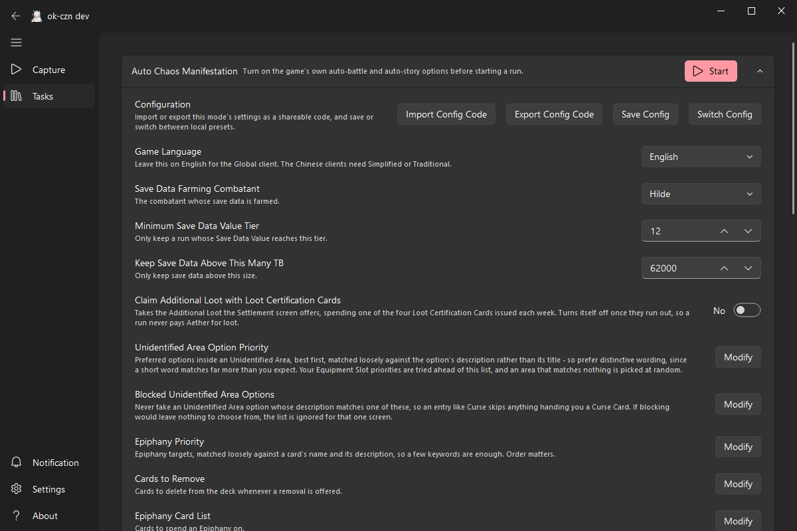
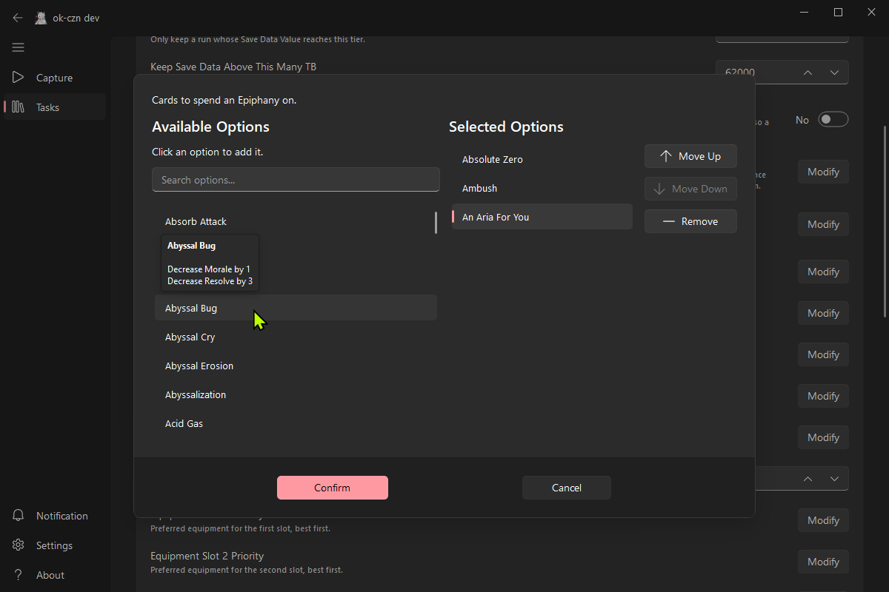

<div align="center">
  <h1 align="center">
    
    <br/>
    ok-czn-english
  </h1>

  <p>
    Automation for the Global (English) PC client of Chaos Zero Nightmare. It plays Chaos Manifestation, Sortie and Story
    for you by reading the screen and pressing buttons, built on <a href="https://github.com/ok-oldking/ok-script">ok-script</a>.
  </p>

  <p><i>It only simulates mouse and keyboard input. It never reads game memory or touches game files.</i></p>
</div>

<div align="center">


[](https://github.com/steve1316/ok-czn-english/releases)
[](https://discord.gg/5Yv4kqjAbm)

</div>

> [!NOTE]
> Started as a fork of [baoxin1100/ok-kes](https://github.com/baoxin1100/ok-kes) and is now developed on its own. It is
> built and tested for the **Global PC client** only. It has drifted far enough from the original that the Chinese
> clients will likely run into trouble - use ok-kes for those.

> [!CAUTION]
> A free, open-source tool for personal use. Use it at your own risk: this project is not responsible for anything that
> happens to your account.

## Quick Start

1. **Download the installer** from [Releases](https://github.com/steve1316/ok-czn-english/releases) and run it. The app
   updates itself on launch.
2. **Run it as Administrator.** The game runs elevated, so without this Windows silently drops every click the app sends.
3. **In the game's settings**, turn on shortcut key display. For Chaos Manifestation, also turn on the game's own
   auto-battle and auto-story.
4. **Pick a mode** on the **Tasks** page and press **Run task**.

## The Tasks page



Pick a mode on the left. Its settings open on the right, and once it has run, an **Info** tab shows how the run went:
time elapsed, the last thing the bot did, floor, credits, runs finished, the team and the deck.

## Modes

### Chaos Manifestation
- Plays whole runs: routes, events, card rewards, shops and rest stops. The game's own auto-battle fights.
- Farms save data for one combatant, keeping only saves above the size you set.
- Re-observes a Chaos map whose modifiers you have blacklisted.
- Handles season-specific mechanics such as Season 3 Persona cards, the Season 4 **Desire Faction** you pick, and Season 5
  Memory cards.
- Stops after a set number of runs, or pauses before a chosen boss so you can take over.

### Sortie
- Fights every battle itself. **Smart Card Play** works out the best play from each card's cost, kind and effect text.
- Each combatant has its own kit, so the bot knows what their cards combo with.
- Drafts combatants by your priority list, or by role when you have not set one.

### Story
- Skips through the story while playing out story battles as well.

## Cards and equipment

- **Epiphanies** go to the cards you pinned in your build preset first, then down your priority list.
- **Removals, copies and Meditation** follow your lists, and act on pinned cards wherever a screen offers them.
- **Shop cards** can be left on the shelf, so Credits go only to removals and equipment. **Monster Card** rewards can be skipped on their own switch.
- **Equipment** goes to the combatant the game marks "Recommended", and a Mythic piece is never passed over. Only
  upgrades are equipped, and spares can be extracted.

## Settings

Every setting has an English name and description. The everyday ones sit at the top, and the rest fold into sections in
the order a run meets them: Map, Battle, Cards, Equipment, Safe Zone, Saves, and one per season. A **Changed** tag marks
anything you moved off its default, and a folded section counts its changes.

Card, combatant and equipment lists are picked from the game's own names, so a typo can never quietly stop a setting
from working. Hover an option to see what it does in game.



**Notifications:** the app sends a Windows notification when a run starts and finishes, and when it has been stuck on
one screen for a minute.

## Troubleshooting

1. **Clicks do nothing:** run the app as Administrator.
2. **Antivirus:** add the install folder to your exceptions, Windows Defender included.
3. **Wrong reads:** turn off graphics card filters and sharpening, keep the game's default brightness, and close
   overlays that draw over the game.
4. **Resolution:** run the game at 16:9, such as 1920x1080 or 1280x720.
5. **Still stuck:** check you are on the latest release, then ask on [Discord](https://discord.gg/5Yv4kqjAbm).

---

## Developer Zone

### Running from source

Use a global Python 3.12. There is no venv.

```bash
pip install -r requirements.txt -r requirements-dev.txt

python main.py          # release mode
python main_debug.py    # debug mode, with extra logging and a local control port
```

```powershell
.\run_tests.ps1         # every tests\Test*.py, in one process bar the manifest check
```

### Layout

| Path | Holds |
| --- | --- |
| `ok_tasks/` | The original game automation, treated as vendored |
| `src/en/` | Everything this fork changes, applied as runtime patches |
| `src/en/kits/` | One module per combatant's kit |
| `i18n/` | The two translation catalogs |
| `scripts/` | Offline tools, not shipped |

### Translations

The two catalogs under `i18n/` run in **opposite directions**:

| Catalog | Direction | Holds |
| --- | --- | --- |
| `ok.po` | Chinese to English | The app's own labels, mode names and setting descriptions |
| `ocr.po` | English to Chinese | Game text read off the screen, rewritten into the Chinese the handlers compare against |

> [!CAUTION]
> **Never put UI strings in `ocr.po`.** It rewrites what the bot reads, so a stray entry there breaks recognition.

The app only reads the compiled `.mo` files, so run `python scripts/compile_i18n.py` after editing a `.po`.

### Offline tools

| Script | Does |
| --- | --- |
| `scripts/capture_window.py <name>` | Saves the game window to `captures/<name>.png` |
| `scripts/ocr_dump.py <image>` | Prints what OCR reads, marking text `ocr.po` does not cover yet |
| `scripts/check_vocab.py` | Reports how much of the handlers' Chinese `ocr.po` covers |
| `scripts/check_points.py <dir>` | Finds hardcoded click points that no longer land on text |

### Releases

Releases are cut by hand with the **Build release on demand** workflow, using a date version like `2026.11.18`.

## Credits

* [baoxin1100/ok-kes](https://github.com/baoxin1100/ok-kes) - the original project
* [ok-script](https://github.com/ok-oldking/ok-script)
* [OnnxOCR](https://github.com/ok-oldking/OnnxOCR)
